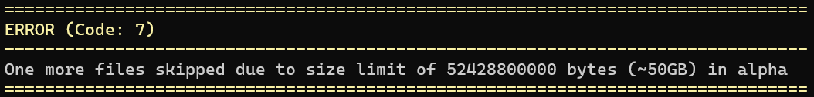

# Snowcopy
Snowcopy is an easy-to-use, fast S3 transfer command line tool with strong data integrity checking.

Main features:
* Auto-tuning parallelization and memory usage based on client hardware, for effortless performance out of the box.
* Data integrity verification for *both* upload and download.
* Very fast transfers. See [benchmarks](#Benchmarking).
* Graphic tui for easy config management
* Incremental transfers: only transfer files not already the destination

## Alpha limitation
There are some known limitations in the alpha, with the current features:

* Snowcopy cannot currently transfer files larger than 50GB.
  * If a file is larger than 50GB is seen, Snowcopy skips it, transfers everything else, then exits with a non-zero status and an error message.
* The amount of memory used by Snowcopy is auto-tuned, but cannot currently be manually configured. It's tuned excessively for the actual needs and will be more optimized at a later time.
* Using a file descriptor limit less than 1024 might crash the program.

We are especially interested in feedback about any instability or correctness issues experienced. Any general feedback is also welcome as an issue or email to lukas.dalgaard@deic.dk or jon.jacobsen@deic.dk

## Release
TODO: link to release and information

## Usage
Before first use, configure a S3 server by running:
```
snowcopy config
```
Which will display a clickable TUI for the user to input the credentials and URL information:


When transferring files, snowcopy uses the [src:dst] pattern:

```
Upload (will automatically create bucket if needed):
	snowcopy cp my-folder profile:bucket
	snowcopy cp file.txt profile:bucket

Download:
	snowcopy cp profile:bucket my-folder

List buckets on server:
	snowcopy ls profile:
	
List files in bucket:
	snowcopy ls profile:bucket

Remove/delete bucket:
	snowcopy rm profile:bucket
```

## Features
Snowcopy preserves modification time of transferred files. It uses the same metadata scheme for it as rclone and is thus compatible with files uploaded by rclone.

### Auto-tuning
Snowcopy scans the computer hardware and network link to determine how the transfer should be configured. It will display the auto-tuned parameters in the console:


**WIP**:
It is possible to tune parameters by hand using flags when running the program. See help for more information:
```
snowcopy help
```

### Incremental upload
Snowcopy uses file name, size and modification time to determine if a file is already present at the destination. If any file is found to already be at the target, a second progressbar will be displayed:


The "total" progress bar will show the total number of files already present at the destination. It can be files that were there before the transfer started or files that has been transferred by the running command. "Existing" is the amount of data that already exist and "at target" is the total newly transferred + existing. 

### Integrity
Snowcopy validates the integrity of all transfers by either md5 or SHA256 depending on the situation. It does so by providing hashes of the content in all uploads. The S3 server then validates that it has received the same content and returns an error if there is a mismatch between the hash and the content.
For downloads, snowcopy stores the necessary metadata to verify the expected hashed contents against the downloaded file. The metadata is stored on the object at the S3 server. 
If there is a mismatch between the hash and the transferred content, the transfer will be retried. If the missmatch is persistent, then snowcopy will abort the transfer with a non-zero exit code.

## Benchmarking
TODO:


## Error codes
Snowcopy can exit an operation with errors in two different ways:



A non-fatal error is where something could not be done, but the rest of the operation is still possible to continue. An example could be a too large file here in the alpha or a S3 object with a key that is not valid as a file on the local file system. The log will contain specific information. A user can trust that the files transferred are correct, but that the transfer is incomplete.


A fatal error will be shown when an irrecoverable situation is encountered. An example could be a disk full error. A user **cannot** trust the state of transferred files at the target.

### List of non-zero exit codes:
 ```
  Unknown = 1
  ServerStateChangeDuringExecution = 2
  RequestFailure = 3
  DiskIoError = 4
  HttpUnsafeError = 5
  SkippedInvalidKeysDownload = 6
  AlphaFileSizeLimitExceeded = 7
 ```

## Goal and non-goals
Goals:
* Ease of use
* Very fast transfer speed
* Data integrity checking
* Compatability with many non-aws S3 systems as well as AWS itself

Non-goals:
* Fully aws feature complete 
* aws-cli compatibility. Any similarities in commands or flags are coincidental and should not be interpreted as intentional compatibility.

## Compatability
We aim to be compatible with many non-aws S3 systems. The challenge here is that aws developed the interface and then other storage implementations copied it. Well, some of it. The 70+ clones implements different subsets of the S3 interface. Therein lies the challenge.

Currently, this tool have been tested against:
* Ceph
* Minio
* Aws

## AI policy
LLM have been used for suggestions, but there are no autonomous code changed not reviewed or committed by a human. 

## Testing & Dependencies
To ensure functionality, we test every change against a local minio instance by giving commands to the snowcopy binary while verifying behaviour and state.

When selecting dependencies, we prioritize [blessed.rs](https://blessed.rs/crates) crates if possible. All other dependencies is vetted to ensure a lot of other people use it as well and that they are still maintained.

## Build
See [readme-dev](Readme-dev.md).

## License
This project is licensed under the European Union Public Licence (EUPL) v1.2.

See the LICENSE file for details.
